# Bloodell — backend

## 1. Objetivo do repositório

O Bloodell é um backend acadêmico para demonstrar uma API de gestão,
distribuição e monitoramento de hemocomponentes. Este README documenta as
entregas técnicas já disponíveis na branch e fornece um roteiro reproduzível
para a demonstração.

Os dados usados no projeto são sintéticos e didáticos. Eles não representam
dados reais de doadores ou pacientes e não substituem protocolos clínicos.

## 2. Sumário das entregas

- [E1 — Build Docker com testes e imagem segura](#e1--build-docker-com-testes-e-imagem-segura)
- [E1-02 — API e PostgreSQL com Docker Compose](#e1-02--api-e-postgresql-com-docker-compose)
- [Demais entregas](#demais-entregas)
  - [E2 — TDD](#e2--tdd)
  - [E3 — Modelo para preenchimento](#e3--modelo-para-preenchimento)
- [Evidências e prints](#evidências-e-prints)

## 3. Como executar a demonstração

### 3.1 Pré-requisitos

Instalar:

- **Git for Windows**, para clonar o repositório e executar comandos Git.
- **Docker Desktop**, com o mecanismo Docker em execução.

O JDK não é necessário para construir a imagem, pois o Dockerfile usa a
imagem de JDK no estágio de construção. O Docker Desktop deve estar aberto
antes dos comandos abaixo.

### 3.2 Validar o Docker

No PowerShell, executar:

```powershell
docker --version
docker info
```

O primeiro comando exibe a versão instalada. O segundo confirma se o daemon
Docker está acessível. Se `docker info` falhar, iniciar o Docker Desktop antes
de continuar.

### 3.3 Obter o projeto

```powershell
git clone <URL_DO_REPOSITORIO> bloodell-backend
Set-Location bloodell-backend
```

### 3.4 Construir a imagem

```powershell
docker build -t bloodell-backend:e1 .
```

Durante a construção, o estágio de build baixa as dependências, disponibiliza
o código necessário e executa os testes antes de empacotar o JAR. Uma falha
de teste deve fazer o comando terminar com erro e impedir a criação de uma
imagem válida.

### 3.5 Conferir a imagem gerada

```powershell
docker image inspect bloodell-backend:e1
docker history bloodell-backend:e1
```

Esses comandos permitem registrar a imagem criada e suas camadas como
evidência da demonstração.

### 3.6 Executar a aplicação (opcional)

```powershell
docker run --rm -p 8080:8080 --name bloodell-e1 bloodell-backend:e1
```

Em outro PowerShell, verificar a aplicação:

```powershell
Invoke-RestMethod http://localhost:8080/actuator/health
```

O resultado esperado é uma resposta de saúde da aplicação. Para encerrar,
pressionar `Ctrl+C` no terminal que executa o container.

## 4. E1 — Build Docker com testes e imagem segura

### Objetivo

Garantir que a imagem Docker só seja produzida depois dos testes unitários e
que a imagem final contenha apenas o necessário para executar a aplicação.
Essa separação reduz o tamanho da imagem e evita levar ferramentas ou arquivos
sensíveis para produção.

### Implementação

O [Dockerfile](./Dockerfile) possui dois estágios:

1. **`builder` (estágio de construção)** — no arquivo, identificado pelo
   alias `build`. Usa uma imagem JDK, prepara o Maven Wrapper e compila a
   aplicação.
2. **Imagem final** — usa uma imagem JRE, que contém somente o ambiente
   necessário para executar o JAR.

No estágio `builder`, são copiados:

- `src/`, com o código-fonte Java;
- `tests/parity/fixtures/`, com as entradas usadas pelo
  `ParidadeAedTest`.

As fixtures são necessárias porque o `ParidadeAedTest` lê esses arquivos para
executar cenários de paridade das estruturas de dados. Uma *fixture* é um
arquivo de entrada fixa usado para repetir o mesmo cenário de teste.

A ordem das etapas é importante:

```text
./mvnw -B -q dependency:go-offline
./mvnw -B test
./mvnw -B -DskipTests package
```

O comando `./mvnw test` é executado antes de gerar ou copiar o JAR. Portanto,
se um teste unitário falhar, o comando `docker build` falha e não deve
produzir uma imagem final considerada válida.

O [.dockerignore](./.dockerignore) exclui do contexto de build:

- `.env`, que pode conter variáveis sensíveis;
- `.git/`;
- artefatos locais, como `target/`, logs e saídas de testes;
- diretórios de build do código acadêmico;
- arquivos de saída de paridade e outros arquivos locais.

Na imagem final são copiados apenas o JRE da imagem-base, o JAR da aplicação e
as dependências necessárias ao runtime. O código-fonte e as ferramentas de
build permanecem no estágio intermediário e não são copiados para a imagem
final. Assim, a imagem final não deve conter:

- código-fonte;
- Maven ou o compilador JDK;
- `.env` ou `.git`;
- segredos ou arquivos pessoais.

### CI e testes de integração

Os testes de integração com PostgreSQL/Testcontainers continuam como gate
obrigatório da CI. *Gate* é uma etapa que precisa passar para que o pipeline
aceite a entrega.

Na configuração de CI, `./mvnw -B verify` executa os testes completos,
incluindo os testes de integração e a paridade C11 x Java. Depois disso, o job
de imagem executa o `docker build` e depende dos jobs de testes.

Os testes com Testcontainers ficam explicitamente na CI porque precisam de um
daemon Docker (o serviço que executa containers). Eles não devem depender de
Docker-in-Docker implícito dentro do build da imagem: o build valida os testes
unitários com `./mvnw test`, enquanto a CI fornece o ambiente apropriado para
PostgreSQL/Testcontainers e executa `./mvnw verify`.

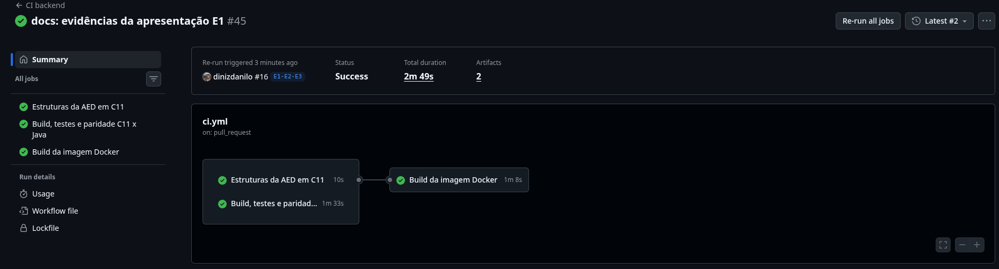

### Passo a passo da evidência

1. Executar `docker --version` e `docker info`.
2. Executar `docker build -t bloodell-backend:e1 .`.
3. Registrar a saída que mostra a execução de `./mvnw -B test`.
4. Registrar a conclusão do empacotamento e a criação da imagem.
5. Executar `docker image inspect` ou `docker history`.
6. Opcionalmente, executar o container e consultar o health endpoint.
7. Consultar a execução da CI para evidenciar os testes de integração e o
   build da imagem como etapas separadas.

### Resultado esperado

- O build termina com sucesso quando os testes unitários passam.
- A imagem `bloodell-backend:e1` é criada.
- A aplicação inicia usando o JAR em uma imagem JRE.
- O build falha se um teste unitário falhar.
- A CI mantém PostgreSQL/Testcontainers e a paridade como gates explícitos.
- A imagem final não leva código-fonte, Maven, compilador, `.env`, `.git` ou
  segredos.

### Evidências relacionadas

- [Dockerfile](./Dockerfile)
- [.dockerignore](./.dockerignore)
- [Workflow de CI](./.github/workflows/ci.yml)
- [Teste de paridade](./src/test/java/br/edu/cesar/bloodell/aed/paridade/ParidadeAedTest.java)
- [Teste de integração PostgreSQL](./src/test/java/br/edu/cesar/bloodell/suporte/TesteDeIntegracao.java)

#### Prints da demonstração

**1. Docker instalado**

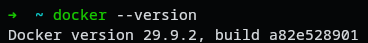

**2. Docker em execução**

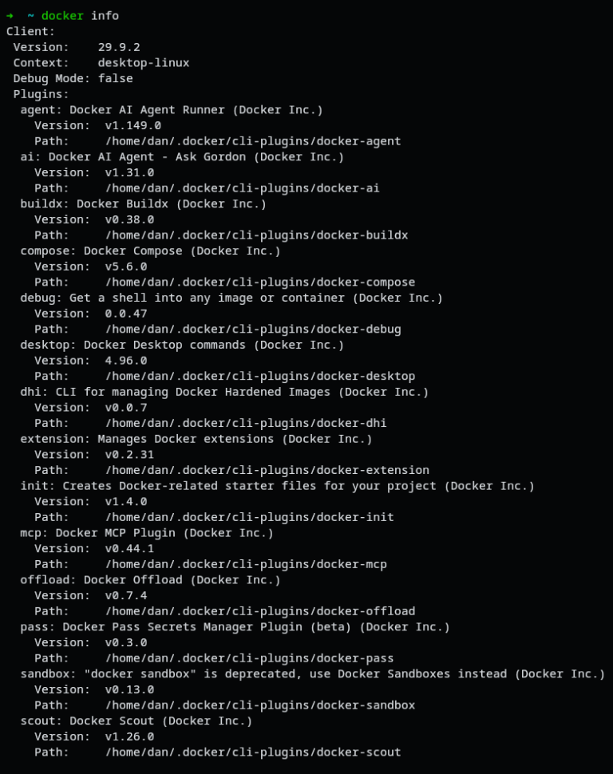

**3. Build executando os testes**

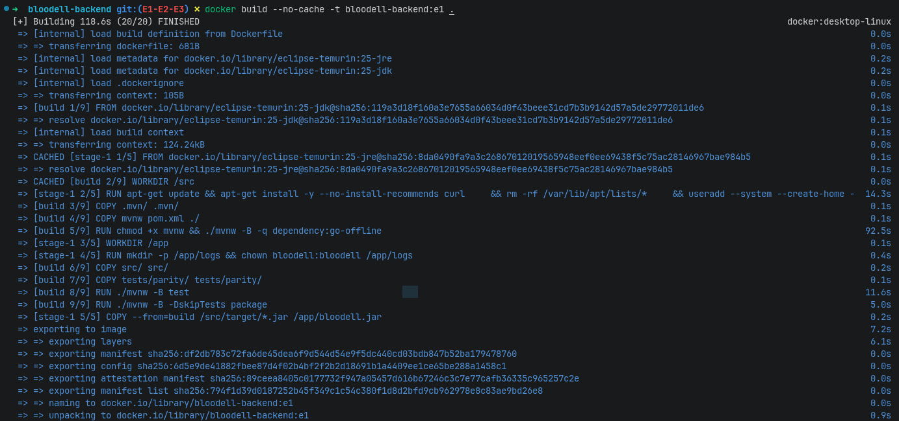

**4. Testes concluídos com sucesso**

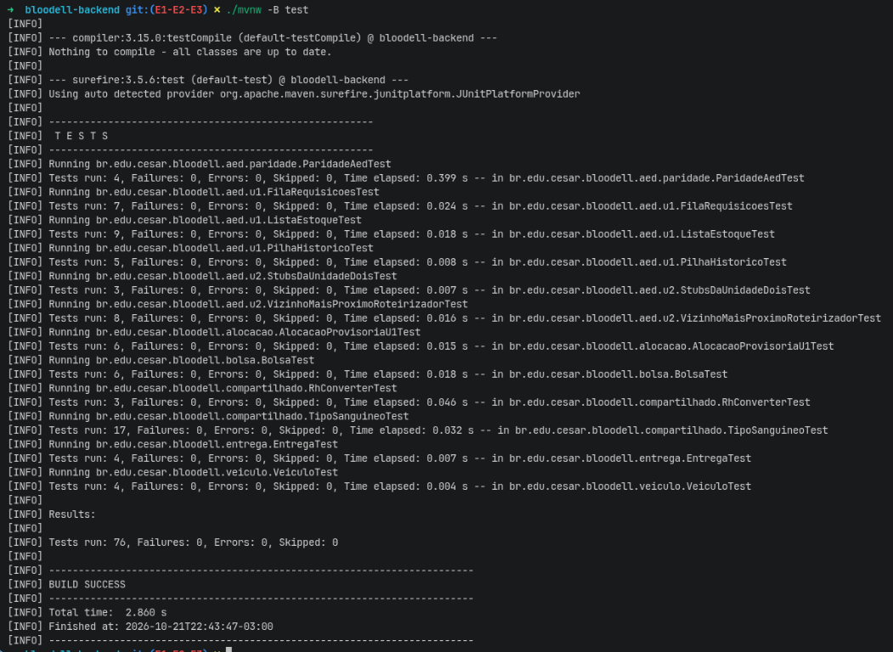

**5. Imagem criada no Docker Desktop**

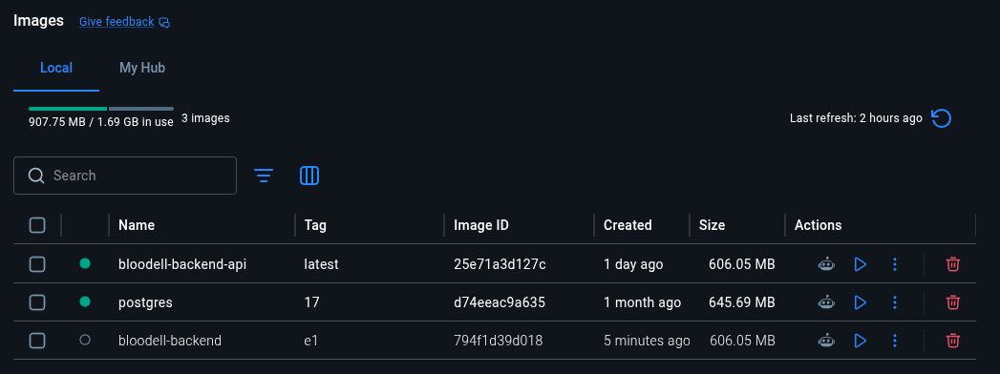

**6. Imagem final sem fontes, Maven, compilador, `.env` ou `.git`**

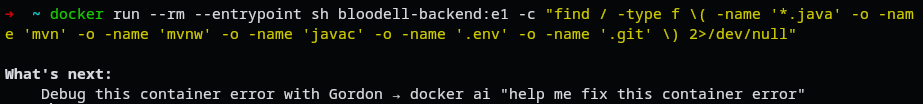

## E1-02 — API e PostgreSQL com Docker Compose

### Objetivo

Demonstrar a execução local da API junto com o PostgreSQL usando Docker
Compose, incluindo a aplicação das migrações do banco, a criação de um
cenário sintético e a preservação dos dados em um volume nomeado.

O escopo desta entrega é **API + PostgreSQL**. A demonstração comprova que os
dois serviços sobem, ficam saudáveis, atendem requisições e mantêm os dados
depois que os containers são recriados.

### Pré-requisitos

No ambiente usado para produzir as evidências, foram encontrados:

- Arch Linux;
- Git;
- Docker;
- Docker Compose.

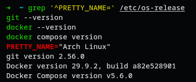

A demonstração final também pode ser repetida no Windows 11 com o Docker
Desktop instalado e em execução.

### Configuração local

O projeto fornece o arquivo [.env.example](./.env.example) como modelo de
configuração. Antes de subir os serviços, criar o arquivo local:

```bash
cp .env.example .env
```

O arquivo `.env` deve ser ajustado apenas para o ambiente local e **não deve
ser versionado**. Ele é ignorado pelo Git e pelo Docker por poder conter
senhas ou outros valores específicos da máquina.

O `.env.example` contém somente valores de exemplo, como o nome do banco, o
usuário, as portas e uma senha que deve ser trocada localmente. Ele serve para
mostrar quais variáveis são necessárias sem expor segredos reais.

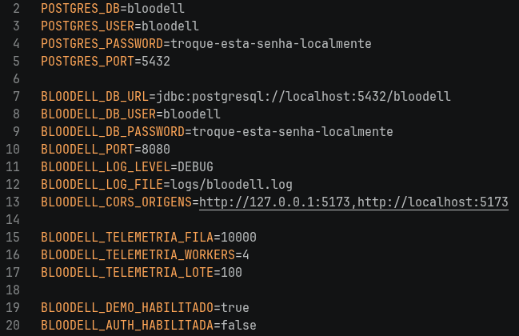

### Subir os serviços

Na raiz do repositório, executar:

```bash
docker compose up -d --build
docker compose ps
```

O primeiro comando constrói a imagem da API e inicia os serviços em segundo
plano. O segundo apresenta o estado dos containers. O arquivo
[compose.yaml](./compose.yaml) define:

- o serviço `api`, publicado localmente na porta `8080`;
- o serviço `postgres`, publicado localmente na porta `5432`;
- verificações de saúde para os dois serviços;
- a dependência da API em relação ao PostgreSQL saudável;
- o volume nomeado `postgres-data` para persistir os dados do banco.

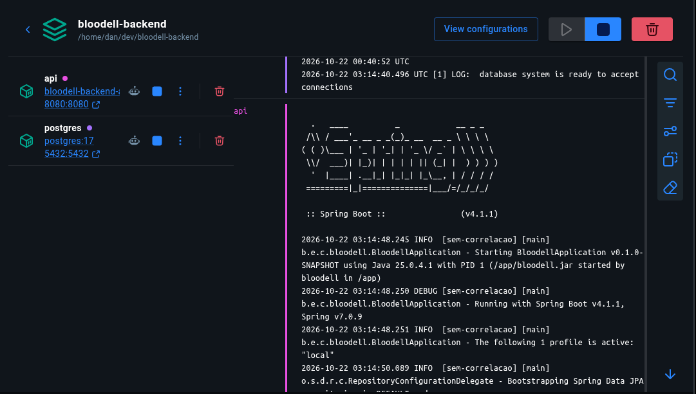

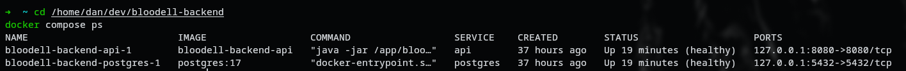

### Verificar a API e as migrações

Com os serviços em execução, consultar o endpoint de saúde:

```bash
curl http://localhost:8080/actuator/health
```

O resultado esperado é HTTP `200` com o status `UP`. Isso indica que a API
está respondendo e que a aplicação conseguiu iniciar sua integração com o
banco.

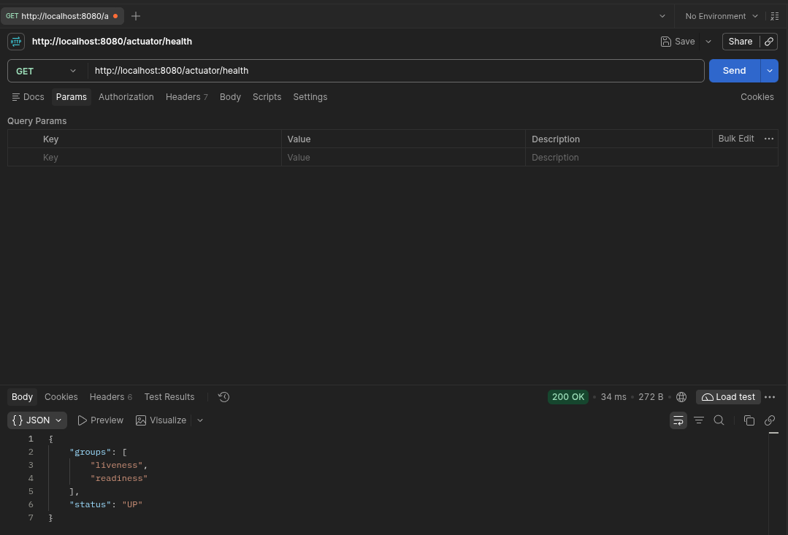

As migrações são aplicadas automaticamente pela aplicação durante a
inicialização. O Flyway registra a versão do esquema e informa quando a
execução foi concluída com sucesso.

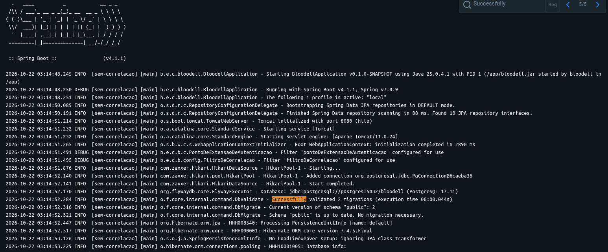

### Criar o cenário sintético

Para popular o banco com dados didáticos e reproduzíveis, enviar:

```bash
curl -X POST http://localhost:8080/api/v1/demonstracoes/cenarios \
  -H "Content-Type: application/json" \
  -d '{"cenario":"e1-volume","semente":42}'
```

O cenário usa dados sintéticos e uma semente fixa. A resposta esperada é
HTTP `201`, com o resumo dos registros criados e os próximos passos de
consulta.

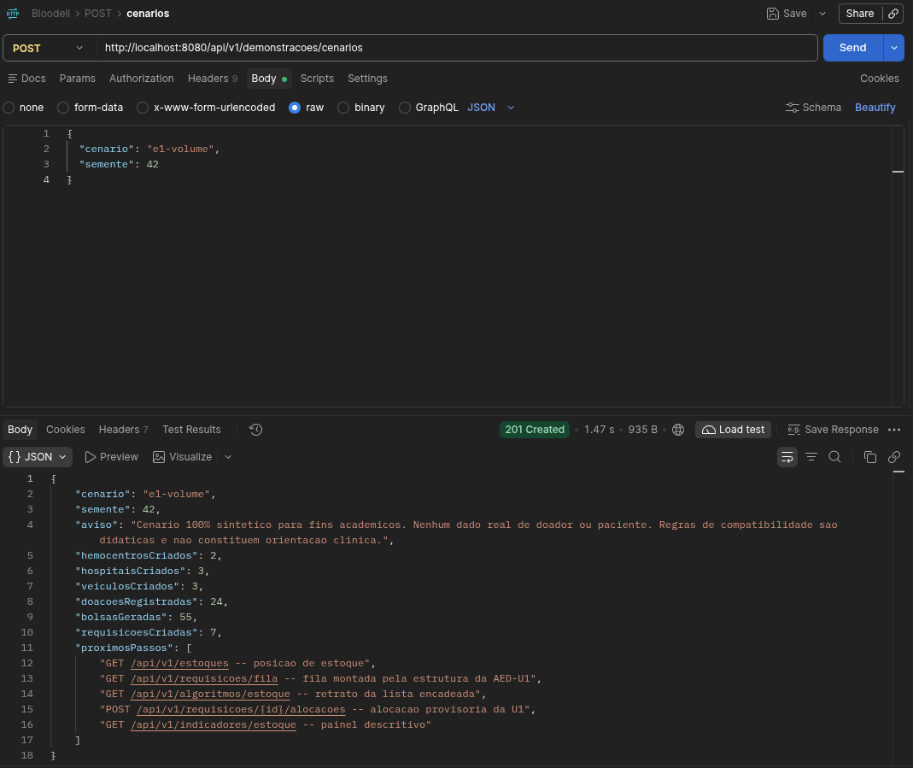

### Verificar o volume e a persistência

O Compose cria um volume nomeado para os dados do PostgreSQL:

```bash
docker volume ls
```

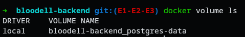

Consultar o estoque antes de recriar os containers:

```bash
curl http://localhost:8080/api/v1/estoques
```

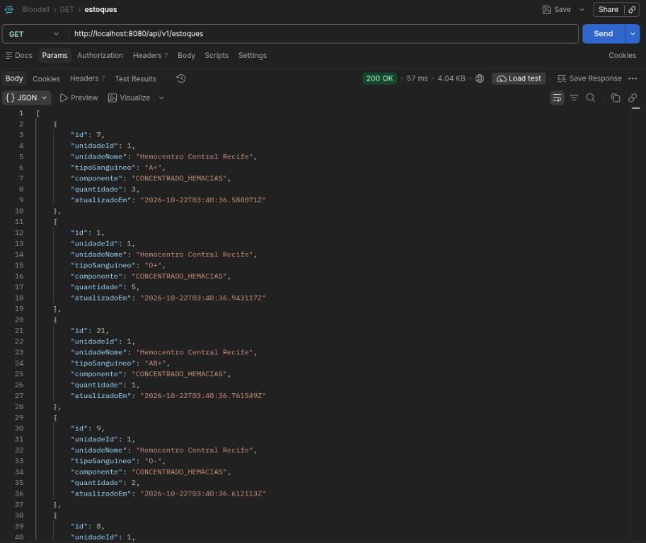

Parar e remover os containers sem remover o volume:

```bash
docker compose down
docker volume ls
```

O comando `docker compose down` remove containers, rede e processos do
Compose, mas preserva o volume nomeado. Não usar `docker compose down -v`
quando o objetivo for comprovar a persistência.

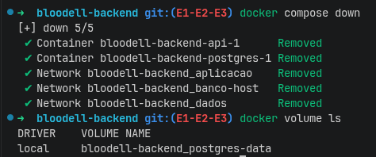

Subir novamente e verificar a saúde dos serviços:

```bash
docker compose up -d
docker compose ps
```

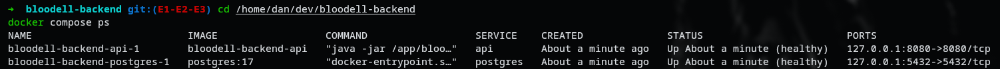

Consultar o mesmo estoque depois da recriação:

```bash
curl http://localhost:8080/api/v1/estoques
```


### Resultado esperado

- A API e o PostgreSQL iniciam pelo Docker Compose.
- Os dois serviços aparecem como saudáveis.
- O Actuator responde com status `UP`.
- As migrações do banco são aplicadas durante a inicialização.
- O cenário sintético é criado com resposta HTTP `201`.
- O estoque pode ser consultado antes e depois da recriação dos containers.
- O volume nomeado permanece após `docker compose down`.
- Os dados do cenário continuam disponíveis depois do novo `docker compose up`.

## 5. Demais entregas

As seções abaixo são modelos reservados para as próximas demonstrações.
Preencher cada uma com objetivo, passos, resultado esperado e evidências,
mantendo a mesma linguagem técnica e didática da E1.

### E2 — TDD

Esta seção registra o progresso documentado da entrega E2 · TDD com base nas
evidências disponíveis no repositório e na execução registrada. As evidências
abaixo não comprovam, isoladamente, o atendimento integral da rubrica da
entrega.

#### Execução dos testes automatizados

Foi executado o comando:

```bash
./mvnw clean verify
```

Na execução registrada, o Maven apresentou `BUILD SUCCESS`. O resumo mostrou
19 testes Java executados, sem falhas, erros ou testes ignorados. Os testes das
estruturas C11 também foram aprovados, incluindo os testes de paridade entre
as implementações. Esse resultado comprova o sucesso dessa execução específica
e não generaliza o resultado para execuções futuras.

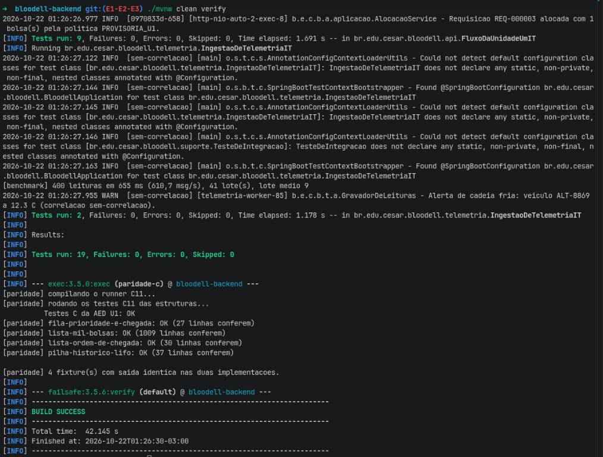

*A imagem comprova a execução registrada de `./mvnw clean verify`, o resumo
dos testes e a conclusão `BUILD SUCCESS`. O arquivo precisa ser copiado para
`docs/evidencias/e2/` se ainda não estiver versionado.*

#### Organização dos testes

A estrutura de `src/test/java` contém testes unitários e de integração. Entre
os arquivos identificados estão:

- [BolsaTest.java](./src/test/java/br/edu/cesar/bloodell/bolsa/BolsaTest.java);
- [EntregaTest.java](./src/test/java/br/edu/cesar/bloodell/entrega/EntregaTest.java);
- [AlocacaoProvisoriaU1Test.java](./src/test/java/br/edu/cesar/bloodell/alocacao/AlocacaoProvisoriaU1Test.java);
- [ConcorrenciaNaAlocacaoIT.java](./src/test/java/br/edu/cesar/bloodell/alocacao/ConcorrenciaNaAlocacaoIT.java);
- [CadastrosIT.java](./src/test/java/br/edu/cesar/bloodell/api/CadastrosIT.java);
- [EntregaIT.java](./src/test/java/br/edu/cesar/bloodell/api/EntregaIT.java);
- [FluxoDaUnidadeUmIT.java](./src/test/java/br/edu/cesar/bloodell/api/FluxoDaUnidadeUmIT.java);
- [IngestaoDeTelemetriaIT.java](./src/test/java/br/edu/cesar/bloodell/telemetria/IngestaoDeTelemetriaIT.java).

Esses arquivos demonstram a existência de diferentes classes de teste, mas não
permitem afirmar que cada regra ou história possui cobertura completa.

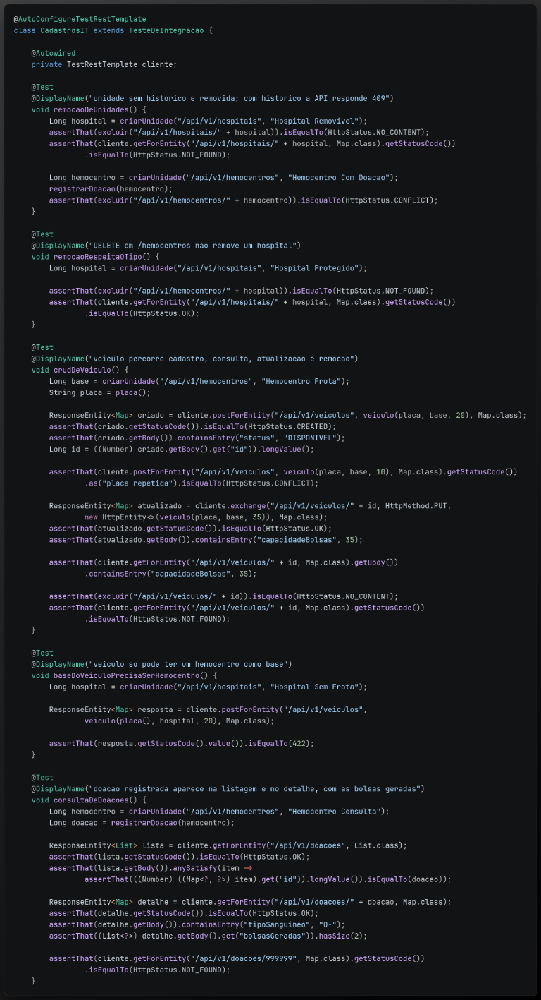

*A imagem comprova a organização de testes unitários e de integração
identificada. O arquivo precisa ser copiado para `docs/evidencias/e2/` se
ainda não estiver versionado.*

#### Configuração do PostgreSQL com Testcontainers

O arquivo [TesteDeIntegracao.java](./src/test/java/br/edu/cesar/bloodell/suporte/TesteDeIntegracao.java)
contém `@SpringBootTest(webEnvironment =
SpringBootTest.WebEnvironment.RANDOM_PORT)`, `@ActiveProfiles("test")`,
`@ServiceConnection`, um `PostgreSQLContainer` baseado em `postgres:17` e a
inicialização explícita do container por `POSTGRES.start()`.

Essa configuração disponibiliza PostgreSQL em container para os testes de
integração e permite ao Spring Boot configurar a conexão de teste. Os valores
de banco, usuário e senha mostrados na configuração pertencem ao ambiente de
teste e não são apresentados como credenciais de produção. A imagem não
comprova que o container é executado pela CI.

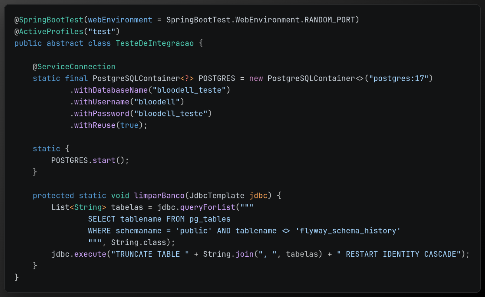

*A imagem comprova a configuração de integração com PostgreSQL/Testcontainers.
O arquivo precisa ser copiado para `docs/evidencias/e2/` se ainda não estiver
versionado.*

#### Cenário de integração da API

O método `consultaDeDoacoes()` de
[CadastrosIT.java](./src/test/java/br/edu/cesar/bloodell/api/CadastrosIT.java):

1. cria um hemocentro;
2. registra uma doação por meio da API;
3. consulta `/api/v1/doacoes` e verifica se a doação aparece na listagem;
4. consulta `/api/v1/doacoes/{id}`;
5. verifica o tipo sanguíneo `O-`;
6. confirma que o detalhe contém duas bolsas geradas; e
7. verifica que a consulta de uma doação inexistente retorna `404 Not Found`.

Em conjunto com a classe base [TesteDeIntegracao.java](./src/test/java/br/edu/cesar/bloodell/suporte/TesteDeIntegracao.java)
e com o resultado registrado da execução dos testes, esse cenário demonstra um
fluxo de integração da API com a persistência configurada para o teste. O
código do método, isoladamente, não é tratado como prova suficiente de
persistência.

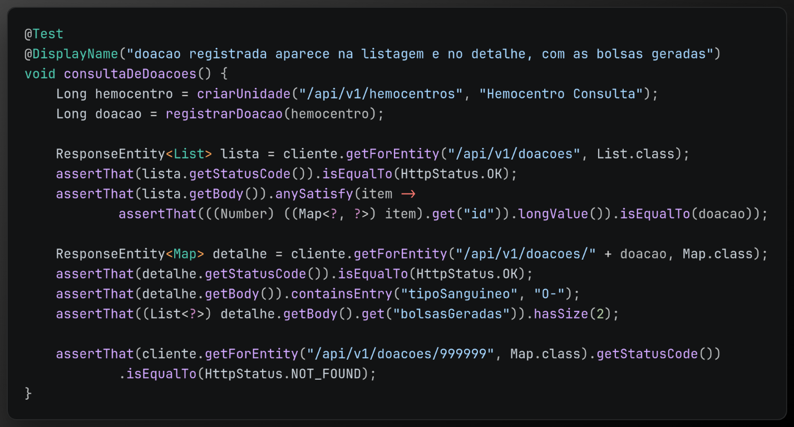

*A imagem comprova as verificações do cenário de consulta de doações. O arquivo
precisa ser copiado para `docs/evidencias/e2/` se ainda não estiver
versionado.*

#### Pendências para concluir a entrega

A rubrica da entrega E2 · TDD ainda exige evidências específicas para:

1. **Story map do PI:** backbone, Release 1 e pelo menos três histórias
   quebradas em tarefas.
2. **Testes por tarefa e por história:** testes unitários para cada tarefa de
   regra, pelo menos um teste de integração com o banco e um teste de
   aceitação por história.
3. **Histórico red → green:** registro demonstrando que o teste foi escrito
   antes da implementação.
4. **Execução e proteção no fluxo de entrega:** testes executados a cada push e
   pull request, com falhas bloqueando o merge.

As evidências reunidas até agora cobrem a execução da suíte, a organização dos
testes, a configuração PostgreSQL/Testcontainers e um cenário de integração
da API. Elas não comprovam, sozinhas, o atendimento integral aos quatro
requisitos acima. Portanto, story map, aceitação por história, histórico
red → green completo e proteção de merge não são marcados como concluídos sem
evidências específicas no repositório e no GitHub.

### E3 — Modelo para preenchimento

**Objetivo:**
Descrever aqui o objetivo da entrega.

**Passos:**
1. Descrever o primeiro passo.
2. Descrever o segundo passo.

**Resultado esperado:**
Descrever o resultado verificável.

**Evidências:**
Inserir links para arquivos, logs, testes e prints.

### E4 — Modelo para preenchimento

**Objetivo:**
Descrever aqui o objetivo da entrega.

**Passos:**
1. Descrever o primeiro passo.
2. Descrever o segundo passo.

**Resultado esperado:**
Descrever o resultado verificável.

**Evidências:**
Inserir links para arquivos, logs, testes e prints.

## 6. Evidências e prints

Salvar os prints em uma pasta versionada e exclusiva para a documentação, por
exemplo:

```text
docs/evidencias/e1/
docs/evidencias/e2/
docs/evidencias/e3/
```

Usar nomes descritivos e ordenados, como:

```text
01-docker-versao.png
02-docker-info.png
03-build-testes.png
04-imagem-gerada.png
05-ci-testcontainers.png
```

Cada print deve mostrar, quando possível, o comando executado e seu resultado.
Na seção da entrega correspondente, inserir uma legenda curta e o caminho
relativo do arquivo. Não salvar `.env`, tokens, senhas, logs com dados
sensíveis ou qualquer segredo nas evidências.
