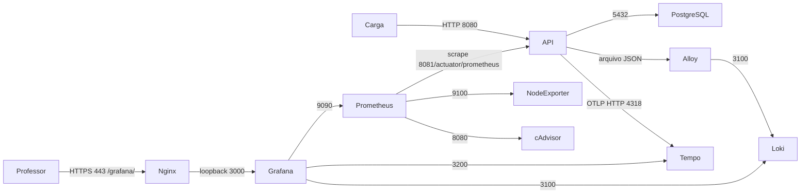

# Observabilidade do BLOODELL

## Execução local

Use Linux com Docker Engine, Compose v2 e Python 3. Docker Desktop mede a VM Linux. No Windows, caso os mounts de host do cAdvisor ou Node Exporter sejam incompatíveis com o Desktop, execute a stack em uma VM Linux. Copie `.env.example` para `.env`, defina uma senha exclusiva do Grafana e a senha do banco. No PowerShell use `Copy-Item .env.example .env`. Preserve o nome do projeto Compose ao atualizar uma instalação existente.

```sh
docker compose up -d --build --wait
docker compose ps
docker compose exec -T api curl -fsS http://localhost:8081/actuator/prometheus
python3 scripts/verificar-observabilidade.py
```

Entre em http://localhost:3000/ com o administrador local e abra a pasta BLOODELL. O gerador prepara dados sintéticos em banco local vazio, registra uma doação com dois componentes e consulta a rastreabilidade a cada 30 segundos. A cada dez ciclos ele consulta uma bolsa inexistente (404). Em produção exige JWT e um hemocentro dedicado. Para pausar apenas a carga use `docker compose stop carga`.



Os contadores `bloodell_doacoes_registradas_total` e `bloodell_bolsas_geradas_total` medem doações e bolsas após o commit. Cada um tem painel próprio. Em Explore consulte `{application="bloodell-backend"} |= "Rastreabilidade"`, expanda o registro e siga o link do trace. O Viewer também pode colar o ID no dashboard Aplicação. Use a janela de três horas para a doação periódica. Para verificar os targets pela interface sem expor o Prometheus, na EC2 obtenha o endereço com `docker inspect -f '{{range .NetworkSettings.Networks}}{{.IPAddress}}{{end}}' "$(docker compose ps -q prometheus)"` e abra um túnel SSH local à porta 9090 desse endereço.

## Primeira publicação na EC2

Endereço informado pela equipe: https://34.235.158.105/. A rota prevista para o professor é https://34.235.158.105/grafana/. Confirme acesso externo após a publicação.

1. Confira memória, disco, arquitetura, versão do Docker e dos cgroups com `free -h`, `df -h`, `uname -m` e `docker info`. Registre SHA, configuração do proxy e nome do projeto atuais. Guarde um backup testado do banco com `pg_dump -Fc`. Nunca remova os volumes para atualizar.
2. Configure no arquivo privado da EC2 `GRAFANA_ADMIN_PASSWORD`, `GRAFANA_ROOT_URL=https://HOST/grafana/`, senhas de banco, segredo JWT, `CARGA_EMAIL`, `CARGA_SENHA` e `CARGA_HEMOCENTRO_ID`. Pela API administrativa, vincule a conta de carga à unidade de teste. Mantenha o seed de produção desligado. Use apenas dados sintéticos.
3. Instale o trecho de `deploy/nginx/observabilidade.conf` no bloco HTTPS do virtual host existente. Confira com `nginx -t` antes de recarregar. Preserve frontend, API e validação do Certbot. Restrinja o firewall às portas já necessárias para HTTPS, redirecionamento HTTP e SSH administrativo.
4. Promova o PR validado de dev para main. A esteira carrega a imagem por SHA, sobe o Compose em prod e verifica a saúde interna, as fontes, o frontend, a proteção da API e o bloqueio público do Actuator.
5. No Grafana, como administrador, crie o usuário do professor, atribua Viewer na organização e teste em janela privada de outra rede. Envie as credenciais pela atividade do Classroom. Confirme a renovação TLS e mantenha a EC2 e a carga ligadas durante toda a janela combinada.
6. Verifique o disco e o consumo com `docker stats --no-stream`. A retenção de logs e traces é de sete dias e o Prometheus usa o padrão de quinze dias. Ajuste à janela e capacidade medidas. Para rollback, restaure o checkout do SHA anterior, as imagens correspondentes e a configuração anterior do Nginx, reaplique a composição desse SHA e valide a rota de saúde dessa versão. Preserve o PostgreSQL e backups dos volumes do Grafana e da observabilidade.

## Evidências para o relatório

O job de imagem guarda PDF e capturas datadas no artefato **observabilidade** do GitHub Actions. Para gerar o documento a partir das capturas em `docs/evidencias/observabilidade`, instale `reportlab` e execute `python scripts/relatorio.py` na raiz. A edição local sem capturas fica identificada como parcial.

Capture com data, hora e SHA visíveis: Compose saudável, scrape interno com tag da aplicação, quatro targets UP, consulta PromQL, dois dashboards com dados, LogQL, trace com vários spans, clique log → trace, código e séries das duas métricas e acesso externo Viewer. Registre link da execução da main e o período de disponibilidade no PDF. Conceda acesso ao professor caso o repositório seja privado e envie o PDF e o link pelo Classroom.
