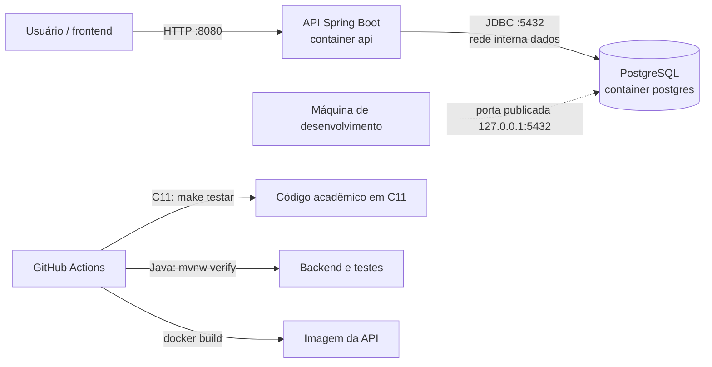

# W04–W05 — Estruturas-base da AED e infraestrutura inicial

Este documento é a evidência da entrega prevista para as semanas 04–05:
repositório, pipeline de CI/CD, topologia de comunicação e primeiras
estruturas de dados. Ele descreve o que está efetivamente versionado no
projeto, sem antecipar algoritmos previstos para a Unidade 2.

## Escopo entregue

| Artefato do cronograma | Evidência no projeto |
|---|---|
| Repositório | Código, documentação, migrations, Docker e testes estão versionados neste repositório Git. |
| Pipeline de CI/CD | `.github/workflows/ci.yml` compila e testa as estruturas em C11, executa `./mvnw -B verify`, guarda relatórios e constrói a imagem Docker. `.github/workflows/deploy.yml` empacota a `main`; a publicação em provedor continua uma decisão pendente registrada no ADR-006. |
| Topologia de comunicação | `compose.yaml`: API Spring Boot e PostgreSQL em containers separados, com rede interna para os dados. |
| Primeiras estruturas | Lista de estoque, fila de requisições e pilha de histórico, implementadas manualmente em Java e espelhadas em C11. |

## Estruturas implementadas

As classes Java ficam em `src/main/java/br/edu/cesar/bloodell/aed/u1/` e não
usam `LinkedList`, `ArrayDeque`, `Stack`, `Queue` ou `Map` para substituir a
estrutura acadêmica. A versão equivalente em C11 fica em `academic/c/`.

| Estrutura | Papel no Bloodell | Operações-base | Integração atual |
|---|---|---|---|
| `ListaEstoque` | Mantém bolsas na ordem de chegada. | inserir, buscar, remover, primeira compatível e listar | `AlocacaoService` hidrata a lista com as bolsas do hemocentro antes da alocação provisória. |
| `FilaRequisicoes` | Ordena pedidos por emergência, urgência e eletiva; preserva FIFO dentro de cada faixa. | enfileirar, desenfileirar, espiar e listar | `RequisicaoService` monta a fila a partir das requisições em espera e expõe o estado em `GET /api/v1/requisicoes/fila`. |
| `PilhaHistorico` | Representa eventos do mais recente ao mais antigo (LIFO). | empilhar, desempilhar, topo e listar | O visualizador de algoritmos usa a pilha para representar o histórico de uma bolsa. |

As três estruturas possuem nós explícitos (`NoBolsa`, `NoRequisicao` e
`NoEvento`), contador de elementos e testes unitários. A análise de
complexidade está em `docs/complexidade-u1.md`; a equivalência C11 ↔ Java e as
fixtures de paridade estão em `docs/equivalencia-cpp-java.md` e
`tests/parity/`.

## Topologia de comunicação

- A API é a única aplicação que acessa o PostgreSQL pela rede Docker `dados`,
  marcada como interna.
- A porta do banco é publicada somente em `127.0.0.1` para desenvolvimento
  local; ela não deve ser exposta em todas as interfaces de rede.
- A API expõe `127.0.0.1:8080` para o frontend local configurado em CORS.
- Não há comunicação externa obrigatória no fluxo base. Telemetria assíncrona
  é processada dentro da própria aplicação e não substitui as estruturas da
  AED.

## Critérios de verificação

1. `cd academic/c && make testar` compila e executa os testes C11.
2. `mvnw.cmd -B test` executa os testes unitários Java, inclusive os das três
   estruturas.
3. `mvnw.cmd -B verify` adiciona testes de integração e a paridade C11 ↔ Java
   (requer Docker e compilador C11).
4. No GitHub Actions, o workflow **CI backend** executa os mesmos testes e
   disponibiliza os relatórios como artefatos quando há falha.

## Limites desta entrega

Matriz de compatibilidade ABO/Rh, seleção FEFO e índice hash são algoritmos da
Unidade 2 e permanecem explicitamente pendentes. O roteirizador de vizinho
mais próximo é documentado separadamente em `docs/escopo-grafo-rotas.md`.
